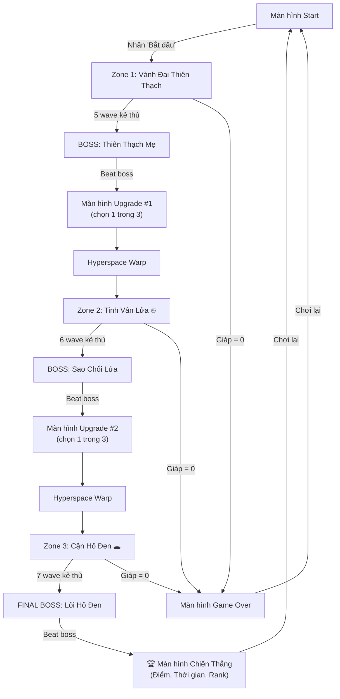
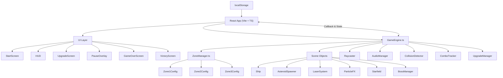

# GAME DESIGN DOCUMENT (GDD): ASTEROID RAIL 3D

---

## 1. Thông tin chung

| Mục | Chi tiết |
|-----|---------|
| **Tên game** | Asteroid Rail 3D (Bắn Thiên Thạch 3D) |
| **Thể loại** | 3D Rail Shooter / Arcade |
| **Nền tảng** | Web Browser (PC / Desktop) |
| **Phong cách đồ họa** | 3D Low-poly / Neon tối giản (dựng hoàn toàn bằng hình khối cơ bản, không dùng asset 3D ngoài) |

---

## 2. Tổng quan Game

### 2.1. Ý tưởng

Người chơi điều khiển hệ thống pháo laser trên một con tàu vũ trụ đang bay tự động (on-rails) xuyên qua **3 vùng không gian nguy hiểm** — từ vành đai thiên thạch, qua tinh vân lửa, đến miệng hố đen. Mỗi zone có môi trường, kẻ thù, cơ chế riêng và kết thúc bằng một trận Boss. Người chơi sinh tồn, lập kỷ lục điểm số và mở khóa nâng cấp giữa các zone.

### 2.2. Điều khiển

| Phím / Thao tác | Hành động |
|------------------|-----------|
| Di chuyển chuột | Di chuyển tâm ngắm (crosshair); tàu nghiêng nhẹ và xoay theo hướng ngắm |
| Click chuột trái (hoặc giữ) | Bắn tia laser về phía tâm ngắm |
| Click chuột phải / `Q` | Bắn Tên lửa dẫn đường (nếu có charge) |
| Phím `Space` hoặc `P` | Tạm dừng / Tiếp tục |

---

## 3. 🌌 Hệ thống 3 Zone — Hành trình xuyên thiên hà

> [!IMPORTANT]
> Mỗi zone là một vùng không gian hoàn toàn khác biệt về **hình ảnh, kẻ thù, cơ chế gameplay** và kết thúc bằng **trận Boss**. Chuyển zone mượt mà bằng hiệu ứng Hyperspace Warp — không reload trang, chỉ swap parameters.

### Zone 1: Vành Đai Thiên Thạch (Asteroid Belt)

*Zone nhập môn — làm quen gameplay cơ bản*

| Yếu tố | Chi tiết |
|---------|---------|
| **Tông màu** | Đen — xám — trắng lạnh |
| **Nền** | Không gian đen sâu, ngôi sao trắng lấp lánh (`THREE.Points`) bay lướt qua |
| **Ánh sáng** | DirectionalLight vàng ấm (ánh mặt trời xa) + AmbientLight nhẹ |
| **Sương mù** | `FogExp2` đen, density thấp — tầm nhìn tốt |

**Kẻ thù:**

| Loại | Hình dạng | HP | Điểm | Hành vi |
|------|-----------|-----|------|---------|
| Thiên thạch thường | `IcosahedronGeometry` xám, `flatShading` | 1–2 | +10 | Bay thẳng về tàu |
| Thiên thạch lớn | `DodecahedronGeometry` đỏ/cam, kích thước x2 | 3 | +30 | Bay thẳng, chậm hơn |

**Cơ chế đặc biệt:** Không — zone thuần túy bắn và né.

**🔥 BOSS: Thiên Thạch Mẹ (Mother Asteroid)**
- Thiên thạch khổng lồ bay chậm (kích thước x5).
- Có **3 lõi phát sáng** (emissive sphere nhỏ gắn trên bề mặt) — bắn trúng lõi gây sát thương x2.
- HP: 15 phát bắn.
- Khi bị phá hủy: vụ nổ lớn (particle burst x3 bình thường) + mưa mảnh vỡ + **+100 điểm bonus**.

---

### Zone 2: Tinh Vân Lửa (Fire Nebula) 🔥

*Zone nguy hiểm — tầm nhìn giảm, phản ứng nhanh*

| Yếu tố | Chi tiết |
|---------|---------|
| **Tông màu** | Cam — đỏ — vàng nóng |
| **Nền** | 2–3 lớp plane lớn bán trong suốt với `AdditiveBlending`, texture gradient cam/đỏ, di chuyển chậm tạo cảm giác mây tinh vân cuộn. Hạt bụi lửa (`THREE.Points` cam nhỏ) lơ lửng khắp nơi |
| **Ánh sáng** | PointLight cam nhấp nháy (intensity dao động sin wave) + DirectionalLight đỏ nhẹ |
| **Sương mù** | `FogExp2` cam/đỏ đậm, density **gấp đôi** Zone 1 → tầm nhìn giảm ~40% |

**Kẻ thù:**

| Loại | Hình dạng | HP | Điểm | Hành vi |
|------|-----------|-----|------|---------|
| Thiên thạch cháy | Như thường + emissive material cam + particle trail lửa phía sau | 2 | +15 | Bay thẳng, nhanh hơn Zone 1 |
| Thiên thạch lớn cháy | Kích thước x2.5, glow mạnh | 4 | +40 | Bay thẳng, chậm |
| Mảnh vỡ tàu | `BoxGeometry` phẳng xoay loạn, material kim loại xám | 1 | +5 | Bay nghiêng, khó ngắm |

**Cơ chế đặc biệt:**
- **Tầm nhìn hạn chế:** Sương mù đặc hơn → thiên thạch xuất hiện bất ngờ → thời gian phản ứng ngắn.
- **Sóng nhiệt:** Cứ mỗi 20 giây, 1 đợt sóng nhiệt (shader distortion nhẹ 2 giây) làm méo tâm ngắm → khó bắn chính xác.

**🔥 BOSS: Sao Chổi Lửa (Fire Comet)**
- Bay theo **quỹ đạo cong** (sine wave trên trục X) thay vì thẳng → khó ngắm.
- Để lại **vệt lửa** dài phía sau (trail particle cam) — thiên thạch nhỏ sinh ra từ vệt lửa.
- HP: 20 phát bắn.
- Có 2 pha:
  - Pha 1 (HP > 50%): Bay cong chậm, dễ bắn.
  - Pha 2 (HP ≤ 50%): Tăng tốc, quỹ đạo cong mạnh hơn, sinh thêm thiên thạch con.
- Khi bị phá hủy: vụ nổ cam khổng lồ + shockwave (vòng tròn mở rộng) + **+200 điểm**.

---

### Zone 3: Cận Hố Đen (Black Hole Proximity) 🕳️

*Zone finale sử thi — visual spectacle + cơ chế lực hấp dẫn*

| Yếu tố | Chi tiết |
|---------|---------|
| **Tông màu** | Tím đậm — cam vàng — đen tuyệt đối |
| **Nền** | Hố đen ở trung tâm phía xa (sphere đen lớn + distortion shader ring xung quanh). Đĩa bồi tụ (accretion disk — ring mesh phẳng cam/vàng emissive xoay chậm quanh hố đen). Sao nền bị kéo dài thành vạch sáng gần hố đen |
| **Ánh sáng** | PointLight cam/vàng từ đĩa bồi tụ + RimLight tím nhẹ từ phía hố đen |
| **Sương mù** | `FogExp2` tím đậm, density trung bình |

**Kẻ thù:**

| Loại | Hình dạng | HP | Điểm | Hành vi |
|------|-----------|-----|------|---------|
| Thiên thạch xoáy | Như thường + xoay nhanh quanh trục | 2 | +20 | Bay theo **quỹ đạo cong xoáy** (bị hút về phía hố đen khi bay) |
| Thiên thạch tăng tốc | Emissive tím, kích thước nhỏ | 1 | +15 | Bay thẳng nhưng **tăng tốc dần** (gia tốc dương) |
| Mảnh vỡ tàu chiến | Nhiều `BoxGeometry` ghép, kích thước lớn | 5 | +50 | Bay chậm, cần nhiều phát bắn |

**Cơ chế đặc biệt:**
- **Lực hấp dẫn hố đen:** Tâm ngắm bị **kéo nhẹ liên tục** về phía hố đen (offset vị trí chuột dần sang trái/phải). Người chơi phải bù lại bằng cách di chuột ngược. Lực tăng dần theo thời gian.
- **Spaghettification:** Thiên thạch gần hố đen bị kéo dài hình dạng (scale Z tăng) và tăng tốc → khó ngắm vì hình dạng méo.

**🔥 FINAL BOSS: Lõi Hố Đen (Black Hole Core)**
- Xuất hiện ở trung tâm phía xa, bao quanh bởi **5 mảnh đĩa bồi tụ bảo vệ** (arc mesh cam/vàng xoay quanh).
- Phải phá hủy từng mảnh đĩa (mỗi mảnh 8 HP) trước khi bắn được vào lõi.
- Lõi HP: 25 phát bắn.
- Lõi bắn ra **vòng sóng năng lượng** (ring mesh tím mở rộng) mỗi 5 giây — không gây sát thương nhưng **đẩy tâm ngắm văng ra rìa** 1 giây.
- Khi lõi bị phá hủy: hiệu ứng **implosion** (mọi thứ bị hút vào, flash trắng) → **Escape Warp** (sao kéo dài, zoom cực nhanh) → **MÀN HÌNH CHIẾN THẮNG**.

---

## 4. Hiệu ứng Chuyển Zone (Zone Transition)

Khi beat boss → hiệu ứng **Hyperspace Warp** 3 giây:

```
Giây 0–1:   Sao bị kéo dài thành vạch sáng (starfield Points → stretched lines)
Giây 1–2:   Tốc độ nền tăng x10, FogExp2 mật độ về 0 → trắng xóa
Giây 2–3:   Flash trắng mờ dần → môi trường zone mới hiện ra từ sương mù mới
```

**Cách triển khai (không reload trang):**
- Thay đổi màu và density `FogExp2`
- Swap material + params cho `THREE.Points` (starfield)
- Thêm/xóa các layer nền (nebula planes, particle systems)
- Swap material preset cho thiên thạch mới
- Chuyển đổi ánh sáng scene (màu, intensity, vị trí)
- Reset spawner với config mới (tốc độ, mật độ, loại kẻ thù)

---

## 5. Hệ thống Nâng cấp giữa Zone (Upgrade System)

Sau khi beat boss Zone 1 và Zone 2, hiển thị **màn hình Upgrade** (React overlay) — chọn 1 trong 3:

### Upgrade sau Zone 1:

| Lựa chọn | Hiệu ứng |
|-----------|----------|
| 🔫 **Laser Kép** (Dual Laser) | Bắn 2 tia song song, diện tích sát thương rộng hơn |
| 🛡️ **Giáp Tăng cường** | Giáp tối đa +2 (tổng 5), hồi +2 Giáp |
| 🚀 **Tên lửa Dẫn đường** | Nhận 2 charges tên lửa (Right-click/Q). Tự dẫn hướng + nổ AOE bán kính 5 đơn vị |

### Upgrade sau Zone 2:

| Lựa chọn | Hiệu ứng |
|-----------|----------|
| ⚡ **Bắn Nhanh** (Rapid Fire) | Cooldown bắn giảm 40% vĩnh viễn |
| 💜 **Laser Xuyên** (Piercing) | Tia laser xuyên qua 1 mục tiêu, sát thương mục tiêu phía sau |
| 🕐 **Bullet Time** | Khi ≥3 thiên thạch trong vùng nguy hiểm (z > -10): tự động slow-motion 0.5x trong 2 giây (cooldown 20s) |

> [!TIP]
> Mỗi lần chơi chọn upgrade khác nhau → build path khác nhau → tăng **replayability**.

---

## 6. Hệ thống Chiến đấu & Điểm số

### 6.1. Hệ thống Giáp (Shield)

- Tàu có **3 điểm Giáp** ban đầu (có thể tăng qua Upgrade).
- Thiên thạch vượt qua tàu → **-1 Giáp**, kèm:
  - Rung camera (0.2 giây)
  - Chớp đỏ màn hình (overlay CSS đỏ 50% opacity, fade out 0.3s)
  - Tiếng va chạm (Web Audio)
- Giáp = 0 → **Game Over** (hoặc **Victory** nếu đang ở Zone 3 Final Boss).

### 6.2. Combo & Điểm

- **Combo streak:** Bắn trúng liên tiếp không trượt → nhân điểm:
  - 3 hit → x2
  - 6 hit → x3
  - 10 hit → x4
  - 15 hit → x5 (tối đa)
- **Hiệu ứng combo:** Tâm ngắm đổi màu (Trắng → Vàng → Cam → Đỏ → Tím).
- **Close Call bonus:** Phá hủy thiên thạch sát tàu (z > -5) → **+20 điểm bonus**.
- Trượt 1 phát → combo reset về x1.

### 6.3. Power-up (rơi từ thiên thạch lớn — tỷ lệ 25%)

| Power-up | Hiệu ứng | Hiển thị |
|----------|----------|----------|
| 💚 **Sửa chữa** | Hồi +1 Giáp (tối đa) | Khối lập phương xanh lá xoay tròn |
| 🔵 **Khiên tạm** | Miễn 1 va chạm tiếp theo | Quả cầu xanh dương bao tàu |
| ⚡ **Bắn nhanh** | Cooldown giảm 50% trong 8 giây | Khối lập phương vàng xoay tròn |

---

## 7. Luồng Game (Game Flow)



### 7.1. Cấu trúc Wave trong mỗi Zone

| Zone | Số wave | Wave 1–3 | Wave 4–5 | Wave cuối | Boss |
|------|---------|----------|----------|-----------|------|
| **Zone 1** | 5 | Thiên thạch thường | Thêm thiên thạch lớn | Mật độ cao | Thiên Thạch Mẹ |
| **Zone 2** | 6 | Thiên thạch cháy | Thêm mảnh vỡ tàu + sóng nhiệt | Tầm nhìn cực thấp | Sao Chổi Lửa |
| **Zone 3** | 7 | Thiên thạch xoáy | Thêm mảnh vỡ tàu chiến + lực hấp dẫn tăng | Hỗn loạn toàn diện | Lõi Hố Đen |

> Mỗi wave kéo dài **15 giây**. Giữa các wave có 2 giây nghỉ (không spawn). Tốc độ và mật độ tăng dần trong mỗi wave.

---

## 8. Kiến trúc Công nghệ (Tech Stack)

> [!NOTE]
> Mô hình **Tách lớp UI và Engine** — React quản lý UI, Three.js chạy 60 FPS độc lập.

| Lớp | Công nghệ | Mô tả |
|-----|-----------|-------|
| **Frontend & UI** | React (Vite + TypeScript) + CSS | Quản lý state màn hình (`START`, `PLAYING`, `UPGRADE`, `PAUSED`, `GAME_OVER`, `VICTORY`), HUD |
| **3D Engine** | Three.js (thuần) | `GameEngine.ts` class riêng. Không dùng `useState` cho tọa độ 3D |
| **Zone Manager** | Module nội bộ | `ZoneManager.ts` — quản lý config zone, chuyển zone, swap params |
| **Ngắm bắn** | Raycaster | Xử lý ngắm bắn bằng chuột |
| **Hiệu ứng** | FogExp2 + PointLight + Particle | Chiều sâu, ánh sáng zone, hiệu ứng nổ/lửa/warp |
| **Renderer** | WebGLRenderer | 60 FPS, `SRGBColorSpace`, `ACESFilmicToneMapping` |
| **Âm thanh** | Web Audio API | Sinh âm thanh procedural (laser, nổ, warp, cảnh báo) |
| **Lưu trữ** | localStorage | High Score, thành tích đã mở khóa |

---

## 9. Thiết kế Hình ảnh & Âm thanh

### 9.1. Mô hình 3D (Low-poly)

| Đối tượng | Cách dựng |
|-----------|-----------|
| **Tàu vũ trụ** | `ConeGeometry` (thân) + `BoxGeometry` (cánh) + particle trail engine phía sau |
| **Thiên thạch thường** | `IcosahedronGeometry` / `DodecahedronGeometry`, `flatShading: true` |
| **Thiên thạch cháy** | Như trên + `MeshStandardMaterial` emissive cam + particle trail lửa |
| **Boss** | Kích thước x5, có các emissive sphere nhỏ làm điểm yếu |
| **Hố đen** | `SphereGeometry` đen + `RingGeometry` cam emissive xoay (đĩa bồi tụ) |
| **Power-up** | `BoxGeometry` nhỏ xoay tròn, emissive theo màu loại |

### 9.2. Hiệu ứng (Game Juice)

| Hiệu ứng | Chi tiết |
|-----------|---------|
| **Tia laser** | Line geometry phát sáng, hiển thị 0.08 giây + PointLight nhỏ theo đầu tia |
| **Nổ thiên thạch** | 6–8 `BoxGeometry` nhỏ văng ra → thu nhỏ → biến mất |
| **Nền sao** | `THREE.Points` (1000–2000 điểm) bay lướt → cảm giác tốc độ |
| **Rung camera** | Khi mất Giáp: offset random camera (x, y) 0.2 giây |
| **Chớp đỏ** | CSS overlay đỏ 50% opacity fade out 0.3 giây |
| **Shockwave nổ boss** | `RingGeometry` trắng mở rộng nhanh + fade → biến mất |
| **Hyperspace Warp** | Sao kéo dài + speed x10 + flash trắng 3 giây |
| **Trail engine tàu** | Particle nhỏ xanh/cam phía sau tàu, drift chậm |

### 9.3. Âm thanh (Web Audio API — procedural)

| Âm thanh | Cách sinh |
|----------|-----------|
| **Tiếng bắn laser** | Sóng sawtooth ngắn (0.1s), pitch giảm nhanh. Pitch tăng theo combo |
| **Tiếng nổ** | White noise burst (0.3s) + low-pass filter decay |
| **Va chạm mất Giáp** | Noise + sine wave trầm (rumble) |
| **Warp** | Sóng sine sweep từ thấp lên cao (1s) + white noise fade |
| **Cảnh báo Giáp thấp** | Khi Giáp = 1: sine pulse 1Hz (nhịp tim) liên tục |
| **Boss xuất hiện** | Low drone (sóng sine trầm 60Hz) fade in |
| **Chiến thắng** | Major chord (C-E-G) sine wave + cymbal noise |

---

## 10. Giao diện người dùng (UI / HUD)

| Màn hình | Nội dung |
|----------|----------|
| **Start** | Tiêu đề game, hướng dẫn ngắn gọn, nút "Bắt đầu" |
| **HUD** | Trên trái: Thanh Giáp (icons) · Trên phải: Điểm & Combo & Best · Giữa: Crosshair CSS · Dưới giữa: Zone hiện tại + Wave counter · (Nếu có) Góc dưới phải: Missile charges |
| **Upgrade** | Overlay 3 card chọn upgrade (sau boss Zone 1, Zone 2) |
| **Pause** | Overlay "Tạm dừng", nút Tiếp tục |
| **Game Over** | Điểm cuối, Zone đạt được, Kỷ lục, Thời gian, nút "Chơi lại" |
| **Victory** | 🏆 Điểm cuối, Thời gian hoàn thành, Rank (S/A/B/C), Kỷ lục, nút "Chơi lại" |

### Hệ thống Rank (Victory):

| Rank | Điều kiện |
|------|-----------|
| **S** | Clear + Giáp đầy + Score > 3000 |
| **A** | Clear + Giáp ≥ 2 |
| **B** | Clear + Giáp = 1 |
| **C** | Clear (vừa đủ sống) |

---

## 11. Kết thúc & Chơi lại

**Game Over (thất bại):**
- Giáp = 0 ở bất kỳ zone nào → dừng game → hiển thị: Điểm, Zone đạt được, Kỷ lục, Thời gian.

**Victory (chiến thắng):**
- Beat Final Boss Zone 3 → hiệu ứng Escape Warp → màn hình Victory với Rank.

**Chơi lại:**
- Nhấn "Chơi lại" hoặc `R` / `Enter`.
- Reset toàn bộ: HP = 3, Điểm = 0, Zone = 1, Upgrade = none, dọn sạch mesh/particle → bắt đầu mới (không reload trang).

---

## 12. Lộ trình triển khai

| Phase | Thời gian | Nội dung |
|-------|-----------|----------|
| **Phase 1: Core** | 0 – 2h | Dựng engine, tàu, spawner, bắn, va chạm, HUD, Start/GameOver — chỉ Zone 1 |
| **Phase 2: Zone System** | 2 – 5h | ZoneManager, Zone 2 & 3, 3 Boss, chuyển zone (Warp FX), màn hình Upgrade |
| **Phase 3: Mechanics** | 5 – 7h | Combo system, Power-up, Tên lửa dẫn đường, Bullet Time, Rank |
| **Phase 4: Polish** | 7 – 9h | Game Juice (trail, shockwave, ánh sáng động), âm thanh procedural, cân bằng độ khó |

---

## 13. Sơ đồ Kiến trúc



---

> [!IMPORTANT]
> File GDD này là tài liệu sống — cập nhật khi có thay đổi thiết kế. Ưu tiên hoàn thiện **Phase 1 (Core)** trước, sau đó lần lượt Phase 2 → 3 → 4.
